<!-- Generated by render/profile.mjs. Edit the script, not this file; a daily workflow regenerates it. -->

<a href="https://www.polymorfa.com"><picture><source media="(prefers-color-scheme: dark)" srcset="cards/header-dark.svg">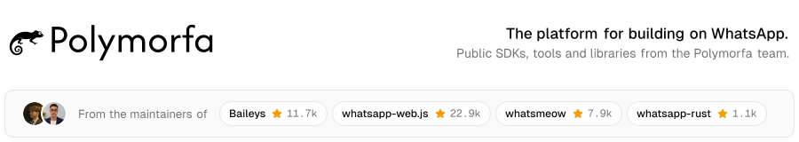</picture></a>

<a href="https://www.polymorfa.com">Website</a>&nbsp;&nbsp;·&nbsp;&nbsp;<a href="https://docs.polymorfa.com">Docs</a>&nbsp;&nbsp;·&nbsp;&nbsp;<a href="https://docs.polymorfa.com/changelog">Changelog</a>&nbsp;&nbsp;·&nbsp;&nbsp;<a href="https://www.polymorfa.com/pricing">Pricing</a>

<picture><source media="(prefers-color-scheme: dark)" srcset="cards/s-build-dark.svg"></picture>
<a href="https://github.com/polymorfa/sdks"><picture><source media="(prefers-color-scheme: dark)" srcset="cards/sdks-dark.svg">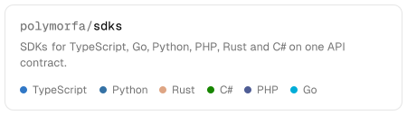</picture></a><a href="https://github.com/polymorfa/cli"><picture><source media="(prefers-color-scheme: dark)" srcset="cards/cli-dark.svg">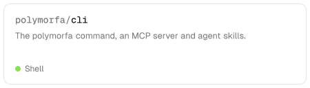</picture></a><a href="https://github.com/polymorfa/integrations"><picture><source media="(prefers-color-scheme: dark)" srcset="cards/integrations-dark.svg">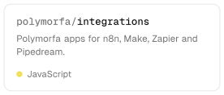</picture></a><a href="https://github.com/polymorfa/signal-node"><picture><source media="(prefers-color-scheme: dark)" srcset="cards/signal-node-dark.svg">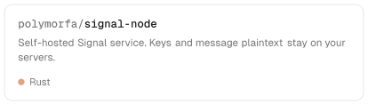</picture></a><a href="https://github.com/polymorfa/agent-kit"><picture><source media="(prefers-color-scheme: dark)" srcset="cards/agent-kit-dark.svg">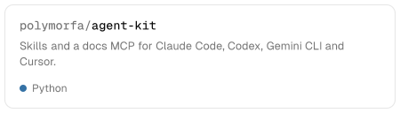</picture></a><a href="https://github.com/polymorfa/sdk-php"><picture><source media="(prefers-color-scheme: dark)" srcset="cards/sdk-php-dark.svg">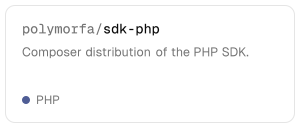</picture></a>

<picture><source media="(prefers-color-scheme: dark)" srcset="cards/s-oss-dark.svg"></picture>
<a href="https://github.com/polymorfa/hypermeow"><picture><source media="(prefers-color-scheme: dark)" srcset="cards/hypermeow-dark.svg">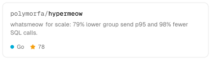</picture></a><a href="https://github.com/polymorfa/cellar"><picture><source media="(prefers-color-scheme: dark)" srcset="cards/cellar-dark.svg">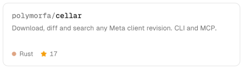</picture></a><a href="https://github.com/polymorfa/jigger"><picture><source media="(prefers-color-scheme: dark)" srcset="cards/jigger-dark.svg">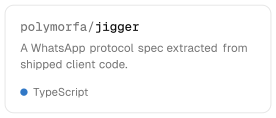</picture></a><a href="https://github.com/polymorfa/sentinel-tests"><picture><source media="(prefers-color-scheme: dark)" srcset="cards/sentinel-tests-dark.svg">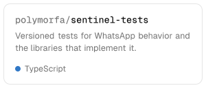</picture></a><a href="https://github.com/polymorfa/libsignal-protocol-go"><picture><source media="(prefers-color-scheme: dark)" srcset="cards/libsignal-protocol-go-dark.svg">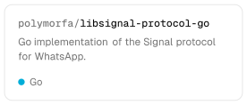</picture></a>

<a href="https://github.com/orgs/polymorfa/repositories"><picture><source media="(prefers-color-scheme: dark)" srcset="cards/more-dark.svg"></picture></a>
